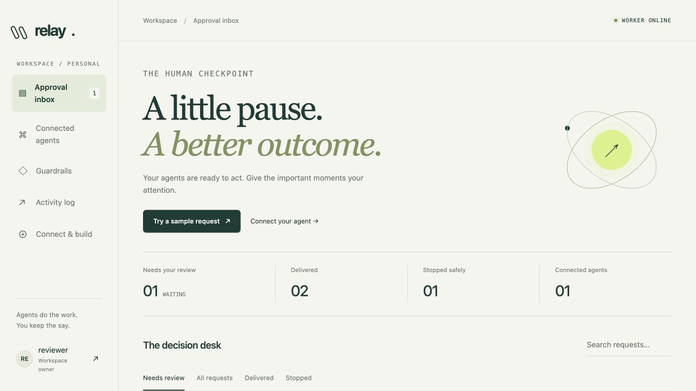

# Relay — Human-in-the-Loop Agent Gateway

A standalone approval service extracted from Orbit's security foundations. Any agent can submit a scoped proposal. Its owner reviews the exact payload; a separate worker executes the approved action once. This is a working local MVP, not an independently audited public service.



## Run

Requires Python 3.11+ on macOS or Linux (Windows users: WSL).

```sh
git clone https://github.com/saicharanteja-vulli/relay-agent-gateway.git
cd relay-agent-gateway
sh start.sh
```

Open http://127.0.0.1:8080 and create your workspace. No default password. The launch script creates its own environment on first run; no Orbit installation or model is required. To change the port: `PORT=8090 sh start.sh`.

1. Select **Try a sample request**. It only proposes a sample file; no file is written yet.
2. Inspect all contents, tick the review acknowledgement, then approve or reject.
3. Refresh the action after execution and download the exact approved file.
4. Under **Connected agents**, create a scoped API key. Copy it once and store it outside source control.
5. Set `RELAY_API_KEY` and run `python examples/submit.py`, or use the API guide at `/docs`.

## Features

- Quiet cream, forest-green and lime interface; open approval rows, review dialog, search, status filters, connected agents, guardrails, timeline and integration guide.
- Local owner account, scrypt password hashes, hashed opaque sessions, eight-hour expiry, logout, CSRF and origin/host checks.
- Per-agent hashed keys, scoped tools, revocation and isolation of agent status endpoints.
- Immutable proposed payloads; SHA-256 approval matching; transactional decisions; idempotent submissions; expiring approvals.
- Separate durable SQLite worker, exclusive worker lock, pre-dispatch expiry/revocation checks, interrupted execution marked unknown without automatic replay.
- Approved new-file creation, approved webhook delivery, and immediate internal log events.
- Append-only application audit trail. Both actions and audit are owner-scoped.

## Architecture

Browser → authenticated approval API → SQLite queue → separate worker → file/webhook

External agent → scoped bearer-key API → same queue

`relay/orbit_security.py` extracts Orbit's `SaveArgs`, `digest`, `password_hash`, `public_target`, `PinnedHTTPS` and `post_webhook` functions. The SQL transaction + exact-digest decision pattern and exclusive file creation are adapted from Orbit. No Orbit accounts, sessions, database, API keys or user reports were copied. Relay has its own data directory.

- `relay/app.py`: authentication, scoped keys, policy decisions and API.
- `relay/core.py`: persistence, audit, worker claim and dispatch.
- `relay/worker.py`: exclusive process lock and crash recovery.
- `static/`: buildless interface and API guide; no build step or external JS/CDN.
- `tests/test_gateway.py`: automated boundary and workflow tests.
- `examples/submit.py`: standard-library Python agent example.

## Policies

| Tool | Behavior | Decision |
|---|---|---|
| `save_file` | New text/Markdown/CSV/JSON file under `data/artifacts/<action-id>` | Human required |
| `send_webhook` | Exact JSON to the owner's configured public HTTPS port-443 endpoint | Human required |
| `log_event` | Store internal message, no tool execution | Automatic |
| Any other tool | Unsupported, rejected by schema | Block |

Policies are fixed in this first version. An agent cannot select its owner, destination, approval status, or artifact path. Changing the webhook blocks waiting/approved webhook proposals. Approval only applies before the stated expiry. Revoking a key blocks pending and approved actions; already-running effects cannot be undone.

## API

`POST /v1/actions` requires `Authorization: Bearer <key>` and accepts `title`, `reason`, `tool`, `arguments`, `idempotency_key`, and optional `expires_in` (60–86,400 seconds; default 3,600). `GET /v1/actions/{id}` returns status and result only to the proposing agent. The bearer API deliberately has no approval endpoint. Dashboard decisions require the owner session and CSRF token.

A duplicate key with identical request content returns the existing action. Reusing it with changed request content returns 409. Errors use JSON `detail`. The full schema is at `/openapi.json`.

The dashboard shows the most recent 200 actions and 300 audit events; older records remain in SQLite. Limits: 50 active agents and 200 outstanding actions per owner. Login is rate-limited per local client IP. There is no public signup or account management UI in v1.

## Validation

```sh
.venv/bin/python -m pytest -q
```

27 automated tests pass. The Orbit → Relay → owner approval → exact file delivery workflow was also tested with a real local Ollama task. Webhooks were tested with mocked transport.

Tests exercise owner/key isolation, unapproved dispatch blocking, rejection, expiry, scoped tools, payload immutability, idempotency conflicts, duplicate decisions, revocation, CSRF, host/origin validation, private-network rejection, webhook configuration changes and recovery without replay. Webhook effects use a mocked transport in tests; no external automation is sent as part of setup.

## Operational boundaries

This version binds only to loopback and rejects other hosts. Do not expose it through a tunnel or bypass host checks. Public hosting needs TLS, secure-cookie deployment configuration, broader abuse/queue limits, account lifecycle and a separate security review. `RELAY_SECURE_COOKIE=1` enables Secure cookies only when a suitable HTTPS deployment is implemented.

Webhook URLs and proposed payloads are stored in local SQLite and are not encrypted at rest. Treat the data directory as sensitive. Source previews are plain text, never rendered as active HTML. Webhook DNS is validated and pinned; TLS validates the original hostname. Redirects are not followed. Endpoint success means HTTP acceptance, not completed downstream automation. The Idempotency-Key header is sent, but receivers may ignore it.

There is no general exactly-once guarantee for external systems: a worker crash or transport timeout may occur after a write. Such actions are `unknown` and are not automatically retried. Files use exclusive creation, so existing files cannot be overwritten. The audit is protected from application updates/deletion; an OS/database administrator can modify local storage. Agent behavior outside this gateway cannot be controlled by Relay.

Set `RELAY_DATA` to an absolute directory and `RELAY_COOKIE_NAME` to a distinct name for separate test instances (browser cookies are shared across ports). Stop the foreground launcher with Ctrl+C to stop both services. Back up the SQLite database using SQLite's backup API and preserve artifacts separately. Do not publish `data/`, `.venv/`, credentials, or test accounts.

## Orbit integration

Orbit's local operator connector can create a `save_file`-only agent for a matching owner account. Orbit proposals appear as **Orbit · filename** with the originating run ID. Only the signed-in Relay owner can approve them. The proposing agent may download its own successfully delivered file through `GET /v1/actions/{id}/artifact`; other agents, unapproved files, and revoked keys are denied. Orbit verifies the downloaded file against the approved text and never executes a duplicate local write.

### Bounded request streaming

Write requests are limited to 100 KB while receiving the body, including chunked requests without Content-Length. Oversized requests stop with HTTP 413 before the full body is buffered. A regression test covers this boundary.
